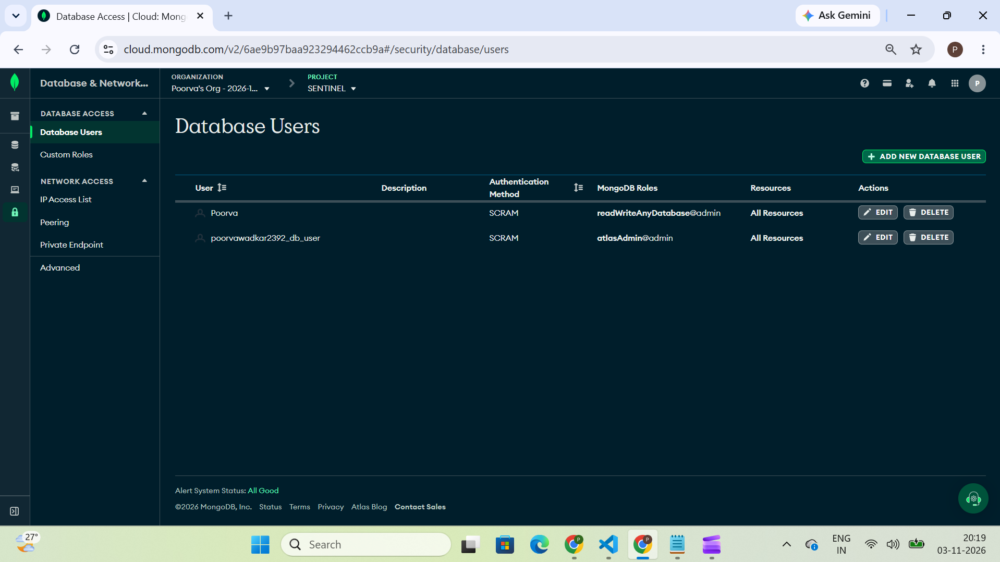
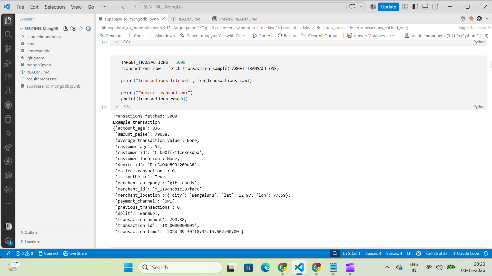
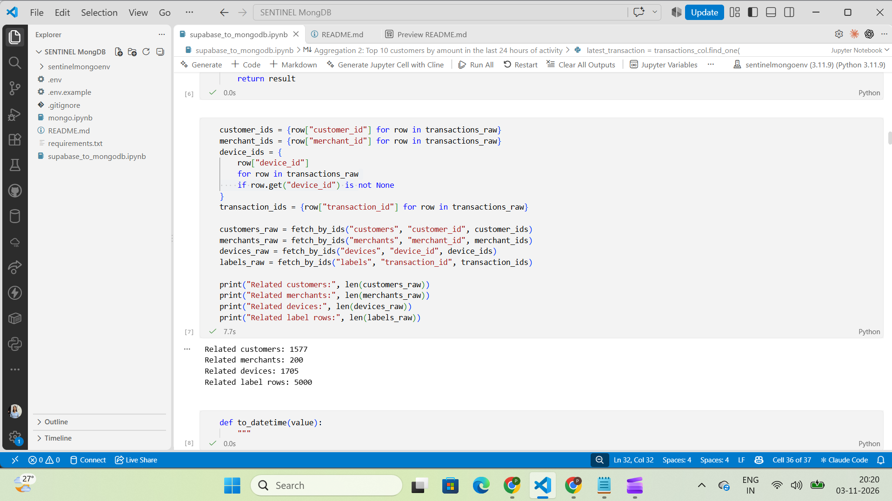
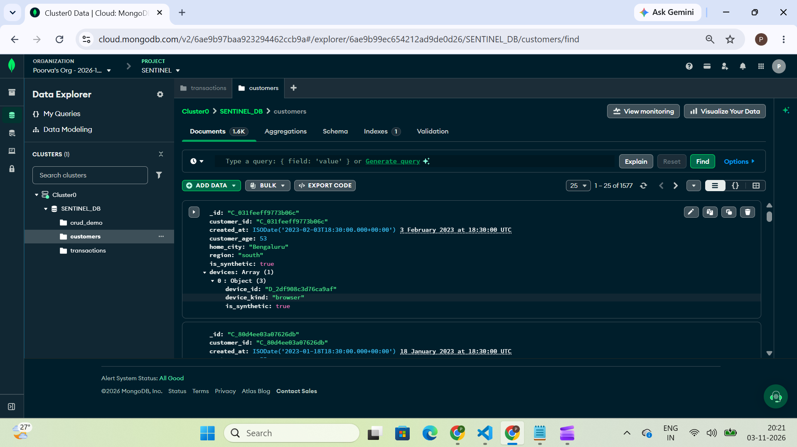
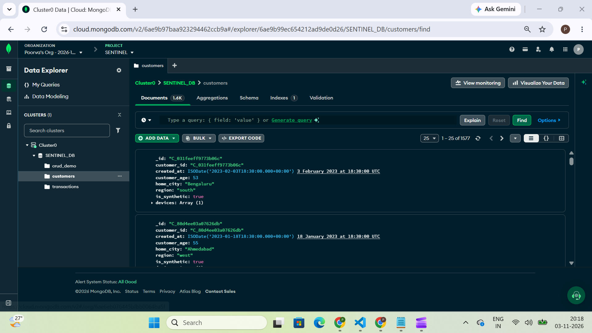
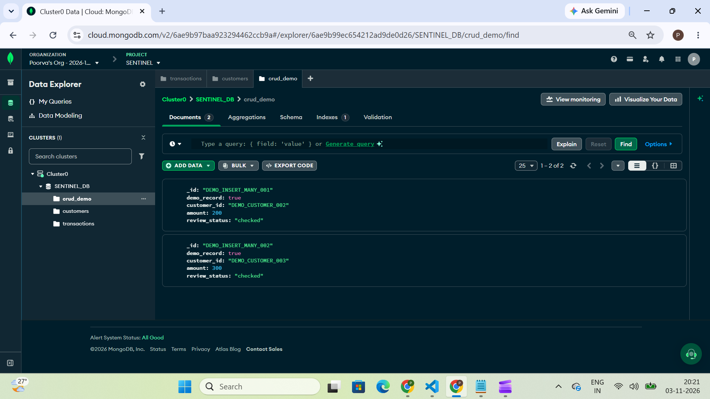

# SENTINEL – MongoDB with Python on SENTINEL transactions

## 1. Project Overview

This project focuses on modelling SENTINEL payment transaction data using MongoDB Atlas and Python (PyMongo). It converts relational data into document-oriented collections using embedding and referencing techniques. The project demonstrates data loading, CRUD operations, indexing, query optimization and aggregation pipelines for analysing transaction activity and fraud patterns.

## 2. Project Structure

```text
sentinel-mongodb/
│
├── README.md
├── supabase_to_mongodb.ipynb
├── requirements.txt
├── .env
├── .gitignore
└── screenshots/
    └── output screenshots
```

## 3. Setup Steps

### Prerequisites

- Python 3.10 or above
- MongoDB Atlas account
- Supabase SENTINEL data access
- Jupyter Notebook

### Step 1: Clone the Repository

```bash
git clone <YOUR_GITHUB_REPOSITORY_URL>
cd sentinel-mongodb
```

### Step 2: Create a Virtual Environment

```bash
python -m venv env
```

Activate the environment on Windows:

```bash
env\Scripts\activate
```

### Step 3: Install Dependencies

```bash
pip install -r requirements.txt
```

### Step 4: Configure Environment Variables

Create a `.env` file in the project root directory and add your credentials:

```env
SUPABASE_URL=your_supabase_url
SUPABASE_KEY=your_supabase_key
MONGO_URI=your_mongodb_connection_string
MONGO_DATABASE=database_name
```

**Security:** Never commit API keys, passwords or database connection strings to GitHub. Always store credentials in a `.env` file and add `.env` to `.gitignore`.

### Step 5: MongoDB Atlas Configuration

1. Create a free MongoDB Atlas cluster.
2. Create a database user with read and write permissions.
3. Configure an IP access rule under Network Access.
4. Copy the MongoDB connection string.
5. Add the connection string to your `.env` file.

---

## 5. How to Run

Open the`supabase_to_mongodb.ipynb` and then run it sequentially to load SENTINEL data, perform CRUD operations, create indexes, analyse query performance and execute aggregation pipelines.

---

## 4. MongoDB Document Design

The project uses two collections: `customers` and `transactions`.

### Customers Collection – Embedding

Device information is embedded inside the customer document using a `devices` array.

**Reason:** A customer can have multiple associated devices. Embedding allows us to retrieve customer information and its associated devices together without performing a separate query for each device.

### Transactions Collection – Embedding and Referencing

- **Embedding:** Merchant information is stored as a nested `merchant` document inside each transaction.
- **Referencing:** Existing `customer_id` and `device_id` fields are retained in transaction documents.

**Reason for embedding merchant details:** Merchant information is useful when analysing individual transactions. Embedding makes relevant merchant attributes directly available within the transaction document.

**Reason for referencing customer and device details:** A customer can have multiple transactions. Storing complete customer and device information repeatedly in every transaction would create unnecessary duplication. Instead, their existing IDs identify the related customer document and device information.

**Note:** The ID columns already existed in the original SENTINEL dataset. No new ID columns were created. We reused them to establish relationships between MongoDB documents.

---

## Project Screenshots

### 1. MongoDB Database User with Read and Write Access


### 2. Fetching 5,000 Transaction Records


### 3. Fetching Customer, Merchant, Device, and Label Data


### 4. Customers Collection with Embedded Device Data


### 5. MongoDB Atlas Database and Collections


### 6. CRUD Operations Output
